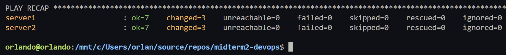

# Práctica 2do Parcial Ansible

## Objetivo de la práctica
Crear un laboratorio con dos servidores Linux utilizando Docker y administrarlos de manera centralizada con Ansible. Se configuran contenedores, se establece un inventario y se ejecuta un playbook para automatizar la creación de directorios, archivos y recolección de información del sistema.

## Comandos para iniciar los contenedores
```bash
docker compose up -d
```

Instalar Python en los servidores (requerido por Ansible):

```bash
docker exec -it server1 bash -c "apt update && apt install -y python3"
docker exec -it server2 bash -c "apt update && apt install -y python3"

```

## Comando para ejecutar el playbook

```bash
ansible-playbook -i inventory.ini playbook.yml

```

## Captura de pantalla de la ejecución

